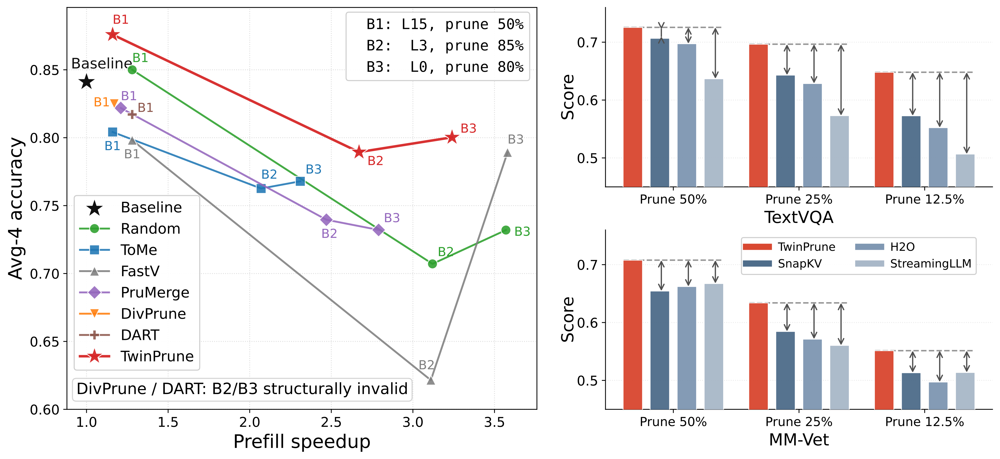
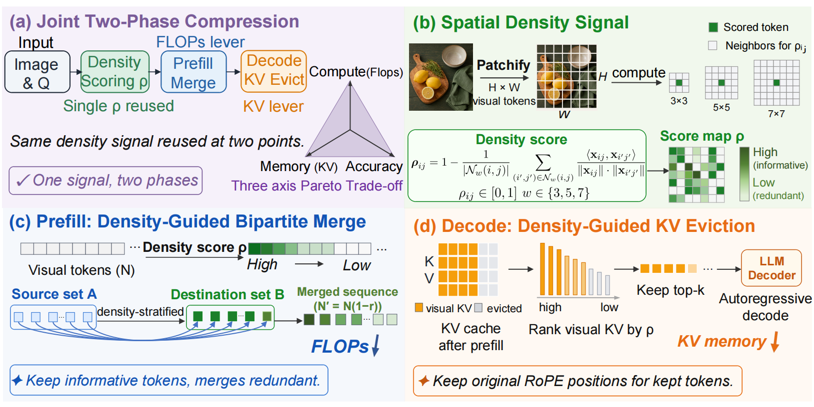
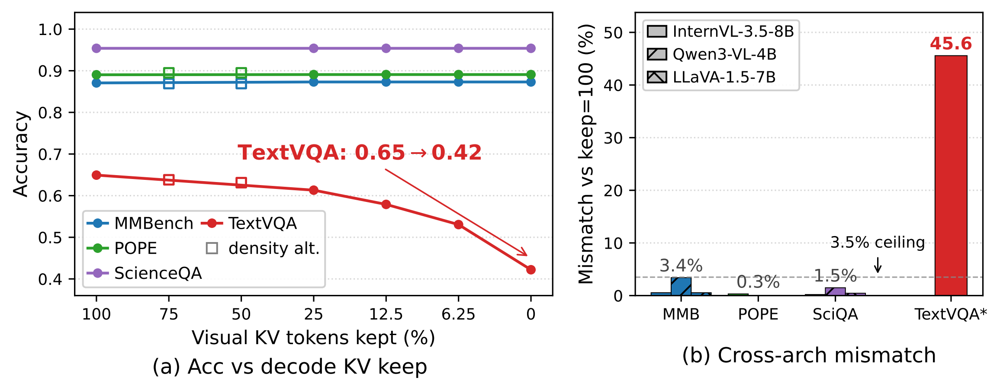
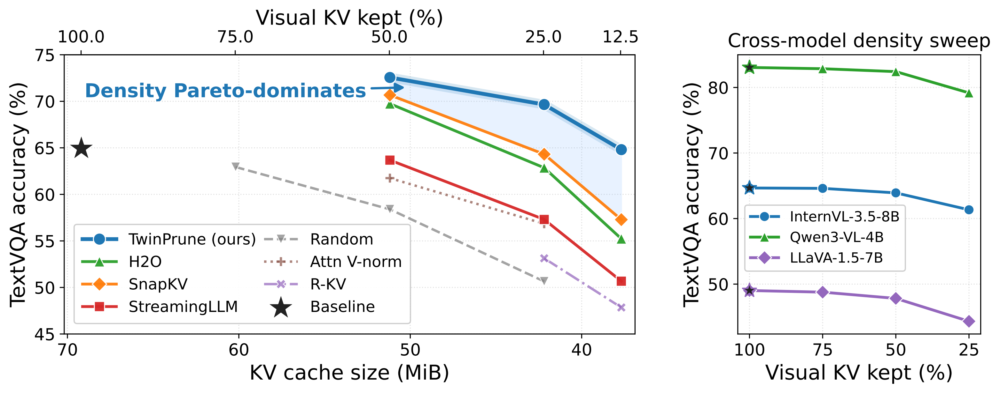

# TwinPrune: Density-Aware Two-Phase Token Pruning for Vision-Language Models


[project](#) |
[arXiv](#)

**Authors:** [Kai Liu](https://kai-liu.cn/), [Anqi Li](https://github.com/starrywiki), [Junxian Li](https://lijunxian111.github.io/), Zhixin Wang, Zhikai Chen, Renjing Pei, [Yulun Zhang](https://yulunzhang.com/) 

## 🔥🔥🔥 News

- **2026-05-10:** The report is released.

## Abstract

> We propose **TwinPrune**, a density-aware two-phase token pruning framework for Vision-Language Models (VLMs). TwinPrune uses a unified spatial-density signal to score token importance in both phases of inference: bipartite visual-token merging during prefill and visual KV cache eviction during decode. The paper shows that prefill-only probes can overestimate decode-stage quality, because benchmarks such as MMBench, POPE, and ScienceQA score only the first decoded token, while full-pipeline benchmarks such as TextVQA, DocVQA, and MM-Vet expose decode sensitivity. TwinPrune therefore evaluates pruning along an honest three-axis Pareto frontier over accuracy, prefill speedup, and decode memory.

## 💡 Highlights



> TLDR: TwinPrune improves VLM inference with a two-phase pruning strategy. It prunes visual tokens during prefill and visual KV cache entries during decode, using one density-aware importance signal for both stages.

## Method



TwinPrune targets the two major visual-token costs in VLM inference:

- **Prefill FLOPs:** visual tokens are numerous and expensive to process before generation starts.
- **Decode KV memory:** visual KV entries remain in cache and are repeatedly attended during autoregressive decoding.

The key design is a single **spatial-density score** $\rho$ reused at both points. High-density tokens are treated as informative visual evidence, while low-density tokens are considered redundant. During prefill, TwinPrune performs density-guided bipartite merging to keep informative tokens and merge redundant ones. During decode, the same ranking guides visual KV eviction, reducing cache memory while preserving the original RoPE positions of retained tokens.

This gives TwinPrune two independent compression levers:

- **FLOPs lever:** prefill merge ratio controls visual-token compute.
- **KV lever:** decode keep ratio controls visual KV cache memory.

Together, these levers form a three-axis trade-off among accuracy, prefill speedup, and decode memory.

## Why Two-Phase Evaluation Matters



Many VLM pruning papers report results on benchmarks that only score the first decoded token. These **prefill probes** are useful, but they do not fully test decode-stage KV pruning because the answer is decided before long autoregressive generation. In contrast, full-pipeline probes such as TextVQA, DocVQA, and MM-Vet score the whole decoded sequence and expose whether decode KV eviction damages generation quality.

The paper shows a clear mismatch: aggressive visual KV removal barely changes MMBench, POPE, or ScienceQA, but can sharply reduce TextVQA accuracy. This motivates evaluating token pruning with both prefill and full-pipeline benchmarks.

## Results



TwinPrune achieves a stronger accuracy-memory Pareto frontier than prior decode-stage pruning methods. On TextVQA, it preserves higher accuracy at smaller visual KV cache sizes compared with H2O, SnapKV, StreamingLLM, random pruning, attention V-norm, and R-KV baselines. Cross-model density sweeps further show that the density signal transfers across VLM families including InternVL-3.5-8B, Qwen3-VL-4B, and LLaVA-1.5-7B.

Combined with prefill-stage bipartite merging, TwinPrune improves the practical inference trade-off from both sides: fewer visual tokens in the prompt pass and fewer visual KV entries in autoregressive decoding.

## 📎 Citation

If you find this work useful, please cite:

```bibtex
@article{liu2026twinprune,
  title   = {TwinPrune: Density-Aware Two-Phase Token Pruning for Vision-Language Models},
  author  = {Liu, Kai and Li, Anqi and Li, junxian and Wang, Zhixin and Chen, Zhikai and Pei, Renjing and Zhang, Yulun},
  journal = {arXiv},
  year    = {2026}
}
```

## 🔑 License

This project is released under the [MIT License](LICENSE).

## 👍 Acknowledgements

We thank the open-source VLM and pruning communities, including InternVL, Qwen-VL, LLaVA, ToMe, FastV, PruMerge, DivPrune, DART, SnapKV, H2O, and StreamingLLM, as well as MMBench, POPE, ScienceQA, TextVQA, DocVQA, and MM-Vet.
