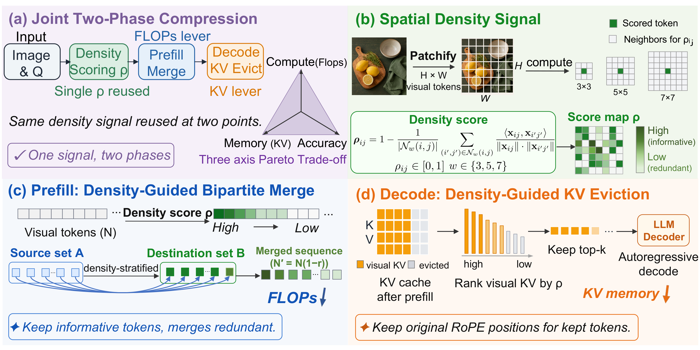
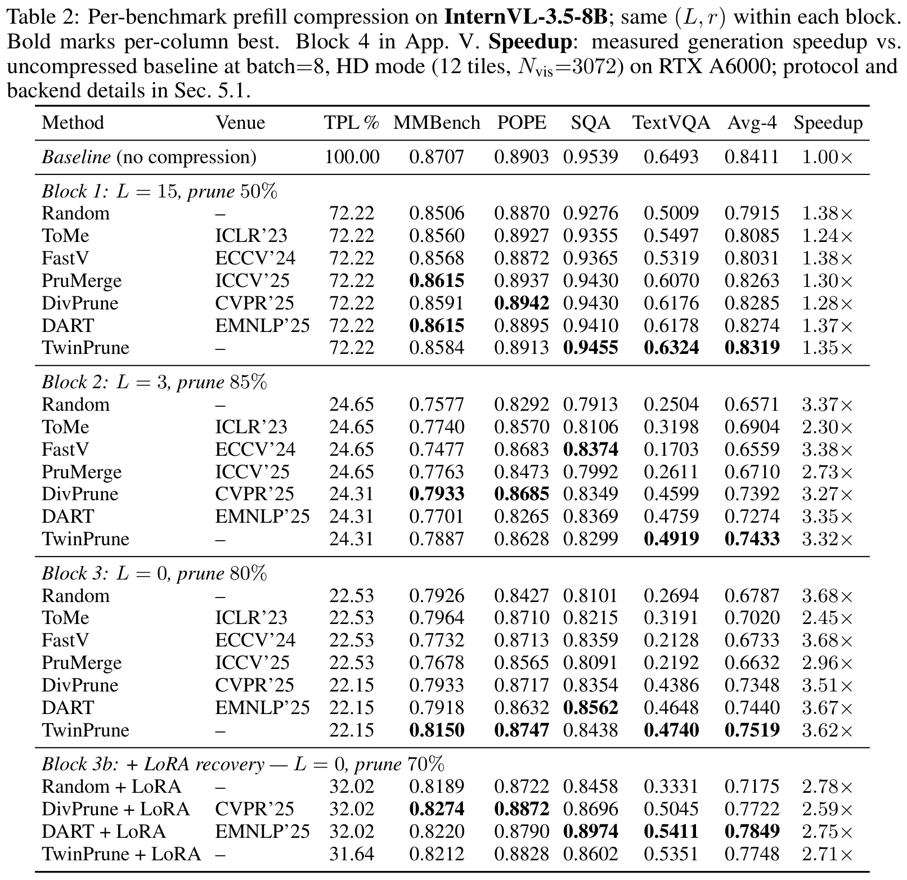
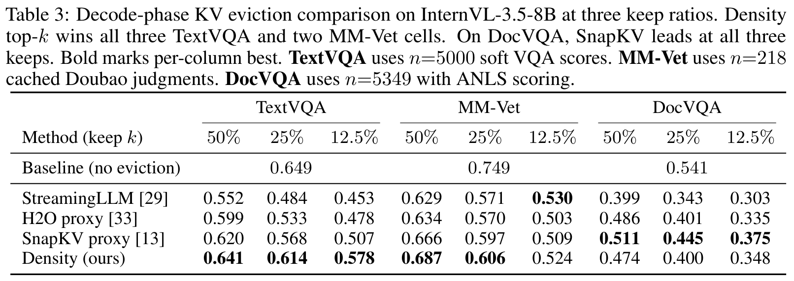

# [🏆NeurIPS'26 Poster] TwinPrune: Density-Aware Two-Phase Token Pruning for Vision-Language Models

Official implementation of **TwinPrune**, accepted at **NeurIPS 2026 (Poster)**.

[Kai Liu](https://kai-liu.cn), Anqi Li, [Junxian Li](https://lijunxian111.github.io), [Zhixin Wang](https://scholar.google.com/citations?user=tZS6bPMAAAAJ&hl=en&oi=sra), [Zhikai Chen](https://scholar.google.com/citations?hl=en&user=6EW56pIAAAAJ), [Renjing Pei](https://scholar.google.com/citations?hl=en&user=zEEMPUUAAAAJ&view_op=list_works&sortby=pubdate), [Yulun Zhang](https://yulunzhang.com)

[Paper](https://arxiv.org/abs/2610.17530) · [Implementation](src/) · [Reproduction](REPRODUCE.md)

#### 🔥 News

- **2026-10-13:** The paper is available on [arXiv](https://arxiv.org/abs/2610.17530).
- **2026:** TwinPrune is accepted at NeurIPS 2026 as a poster.

---

> **Abstract:** TwinPrune uses spatial density to guide visual token selection during prefill and visual KV pruning during decoding. Its joint path reuses the cached prefill scores among surviving tokens. We evaluate these two phases separately on InternVL, Qwen3-VL, and LLaVA, using matched controls and full-sequence benchmarks to study accuracy, prefill computation, and KV memory.

### Pipeline



## 🔗 Contents

1. [Codes](#codes)
2. [Testing](#testing)
3. [Results](#results)
4. [Acknowledgements](#acknowledgements)

### Codes

```text
src/
├── latc.py                                  InternVL prefill pruning
├── qwen_latc.py                             Qwen3-VL prefill pruning
├── llava_latc.py                            LLaVA prefill pruning
├── *_decode_eviction_engine.py              Visual KV pruning
└── internvl_cached_signal_joint_engine.py   Cached-score joint pruning

twinprune/                                  Evaluation and metric verification
configs/                                    Experiment configurations
```

## Testing

See [REPRODUCE.md](REPRODUCE.md) for environment setup, checkpoints, datasets, and full benchmark evaluation commands. After configuring your model and data paths, run a 20-sample quickstart:

```bash
bash scripts/quickstart.sh
```

## Results





## 📎 Citation

If you find TwinPrune useful, please cite:

```bibtex
@inproceedings{liu2026twinprune,
      title={TwinPrune: Density-Aware Two-Phase Token Pruning for Vision-Language Models},
      author={Kai Liu and Anqi Li and Junxian Li and Zhixin Wang and Zhikai Chen and Renjing Pei and Yulun Zhang},
      booktitle={Advances in Neural Information Processing Systems},
      year={2026},
      eprint={2610.17530},
      archivePrefix={arXiv},
      primaryClass={cs.CV},
      url={https://arxiv.org/abs/2610.17530}
}
```

## Acknowledgements

We thank the authors of [InternVL](https://github.com/OpenGVLab/InternVL), [Qwen3-VL](https://github.com/QwenLM/Qwen3-VL), [LLaVA](https://github.com/haotian-liu/LLaVA), and the compared pruning methods.

Our code is released under the [MIT License](LICENSE).
